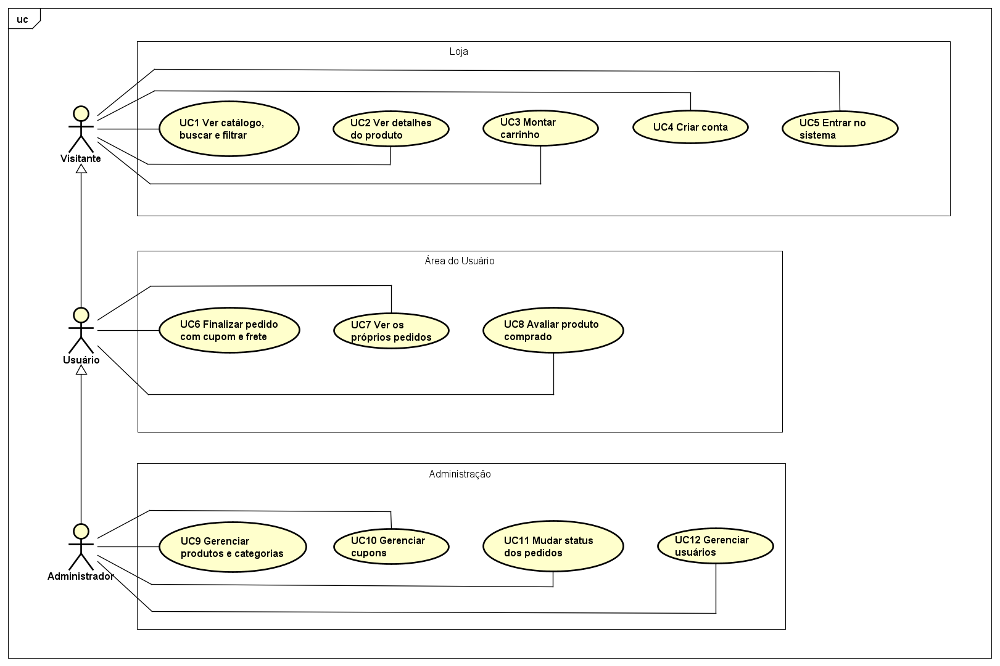

# 2. Diagrama de casos de uso

## Atores

- Visitante: quem entra no site sem ter conta.
- Usuário Comum (`ROLE_USER`): cliente cadastrado e logado. No diagrama aparece como Usuário.
- Administrador (`ROLE_ADMIN`): quem cuida da loja.

O Usuário Comum faz tudo o que o Visitante faz, e o Administrador faz tudo o que o Usuário Comum
faz. No diagrama isso aparece como herança entre os atores.

## Diagrama

O diagrama foi feito no Astah UML. O arquivo original é
[diagrama-casos-de-uso.asta](diagrama-casos-de-uso.asta) e a imagem exportada é esta:

Para abrir ou editar: Astah UML, menu **Arquivo > Abrir**. Para gerar a imagem de novo:
**Arquivo > Exportar Imagem**, formato PNG.

## Casos de uso em texto

### Visitante (área Loja)
| Caso de uso | Descrição |
|---|---|
| UC1 Ver catálogo, buscar e filtrar | Lista os produtos, busca pelo nome e filtra por categoria |
| UC2 Ver detalhes do produto | Vê preço, descrição, categoria e se há estoque |
| UC3 Montar carrinho | Adiciona, altera a quantidade e remove itens, sem passar do estoque |
| UC4 Criar conta | Cadastra-se com nome, e-mail e senha |
| UC5 Entrar no sistema | Faz login com e-mail e senha |

### Usuário Comum (Área do Usuário, além dos anteriores)
| Caso de uso | Descrição |
|---|---|
| UC6 Finalizar pedido com cupom e frete | Confirma o pedido, vê o total e o estoque é descontado. Cupom e frete são diferenciais planejados |
| UC7 Ver os próprios pedidos | Lista o histórico e o status de cada pedido (só os dele) |
| UC8 Avaliar produto comprado | Dá nota e comentário a um produto que comprou. Diferencial planejado |

### Administrador (área Administração, além dos anteriores)
| Caso de uso | Descrição |
|---|---|
| UC9 Gerenciar produtos e categorias | Cadastra, lista, edita e exclui produtos e categorias |
| UC10 Gerenciar cupons | Cadastra, lista, edita e exclui cupons de desconto. Diferencial planejado |
| UC11 Mudar status dos pedidos | Vê todos os pedidos e muda o status. Cancelar devolve o estoque |
| UC12 Gerenciar usuários | Lista os usuários e troca o perfil entre cliente e administrador (menos o próprio) |

Os casos de uso marcados como diferencial estão detalhados no documento
[5. Interface e design](5-interface-e-design.md).

## Fluxo principal: da vitrine ao pedido

1. O visitante abre o catálogo e adiciona produtos ao carrinho.
2. No carrinho, ele clica em Entrar para finalizar e faz login (ou cadastro).
3. De volta ao carrinho, confere os itens e o total.
4. Ao clicar em Finalizar compra, o pedido nasce como Aguardando pagamento (na próxima etapa o
   estoque será descontado nesse momento).
5. O admin acompanha o pedido e vai mudando o status até Entregue.
