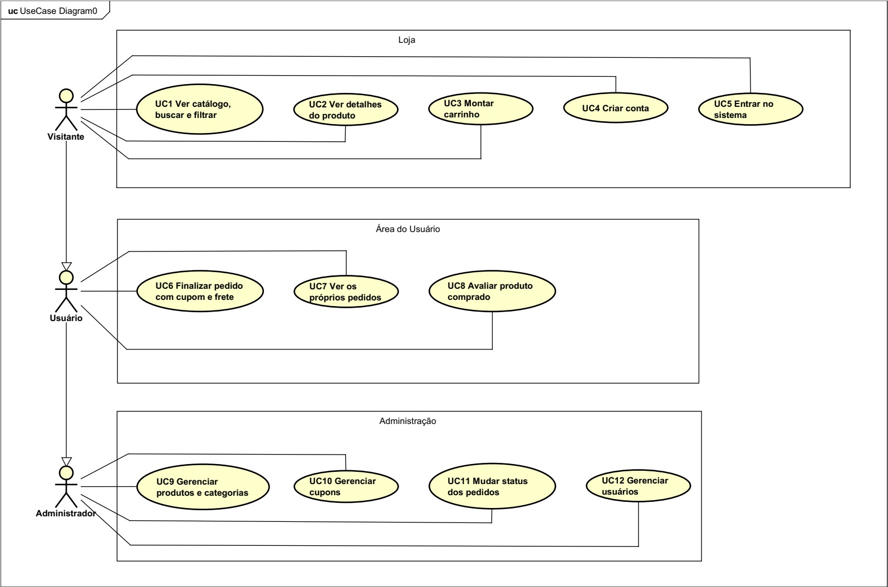

# 2. Diagrama de casos de uso

## Atores

- **Visitante:** quem entra no site sem ter conta.
- **Usuário Comum (`ROLE_USER`):** cliente cadastrado e logado.
- **Administrador (`ROLE_ADMIN`):** quem cuida da loja.

O Usuário Comum faz tudo o que o Visitante faz, e o Administrador faz tudo o que o Usuário Comum faz.

## Diagrama

O diagrama foi feito no Astah UML pelo grupo. O arquivo original é
[diagrama-casos-de-uso.asta](diagrama-casos-de-uso.asta) e a imagem exportada é esta:

Para abrir ou editar: Astah UML, menu **Arquivo → Abrir**. Para gerar a imagem de novo:
**Arquivo → Exportar Imagem**, formato PNG.

## Casos de uso em texto

### Visitante
| Caso de uso | Descrição |
|---|---|
| UC1 Ver catálogo, buscar e filtrar | Lista os produtos, busca pelo nome e filtra por categoria |
| UC2 Ver detalhes do produto | Vê preço, descrição, estoque e avaliações |
| UC3 Montar carrinho | Adiciona, altera a quantidade e remove itens (o sistema não deixa passar do estoque) |
| UC4 Criar conta | Cadastra-se com nome, e-mail, senha e CPF opcional |
| UC5 Entrar no sistema | Faz login com e-mail e senha |

### Usuário Comum (além dos anteriores)
| Caso de uso | Descrição |
|---|---|
| UC6 Finalizar pedido com cupom e frete | Confirma o pedido, aplica cupom, vê o frete e o total; o estoque é descontado |
| UC7 Ver os próprios pedidos | Lista o histórico e abre o detalhe de cada pedido (só os dele) |
| UC8 Avaliar produto comprado | Dá nota de 1 a 5 e escreve um comentário, uma vez por produto |

### Administrador (além dos anteriores)
| Caso de uso | Descrição |
|---|---|
| UC9 Gerenciar produtos e categorias | Cadastra, lista, edita e exclui produtos e categorias |
| UC10 Gerenciar cupons | Cadastra, lista, edita e exclui cupons de desconto |
| UC11 Mudar status dos pedidos | Vê todos os pedidos e muda o status; cancelar devolve o estoque |
| UC12 Gerenciar usuários | Lista os usuários, promove a administrador e ativa ou desativa contas |

## Fluxo principal: da vitrine ao pedido

1. O visitante abre o catálogo e adiciona produtos ao carrinho.
2. Ao clicar em **Finalizar compra**, o sistema pede login (ou cadastro).
3. Na tela de confirmação ele vê itens, desconto do cupom, frete e total.
4. Ao confirmar, o pedido nasce como **Aguardando pagamento** e o estoque é descontado.
5. O admin acompanha o pedido e vai mudando o status até **Entregue**.
6. Depois da compra, o cliente pode avaliar o produto.
