# 5. Interface e design

## Telas planejadas (design no Canva)

As telas do sistema foram desenhadas com o mesmo visual do site e estão na pasta
[`telas`](telas/), em PNG, na ordem em que aparecem no uso do sistema. São as imagens usadas no
design do Canva. Os dados são de exemplo.

As telas de confirmação do pedido, de detalhe do pedido e os cadastros de categorias e usuários
seguem o mesmo padrão e serão desenhadas na próxima etapa.

### Loja

Catálogo: busca por nome, filtro por categoria e os cartões dos produtos.

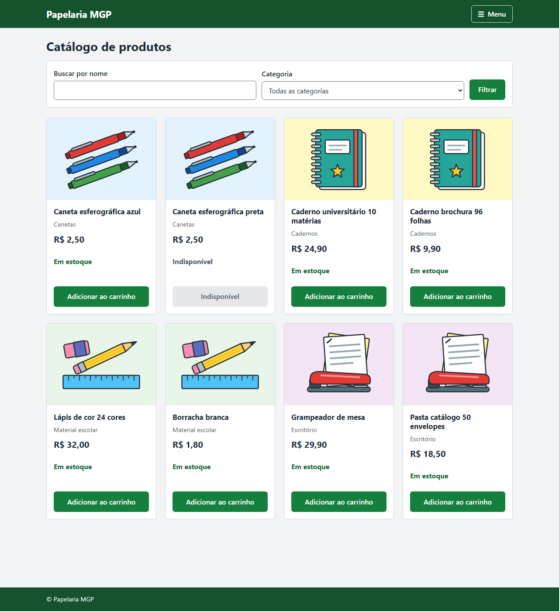

Produto: imagem, preço, estoque, descrição e o botão de adicionar ao carrinho.

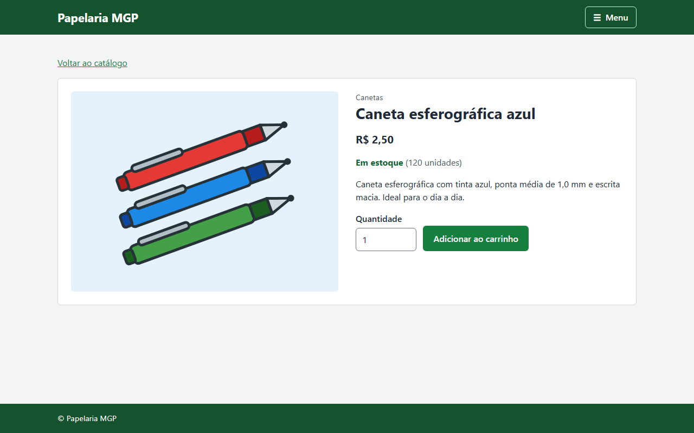

Carrinho: itens com quantidade, resumo do total e o botão de finalizar.

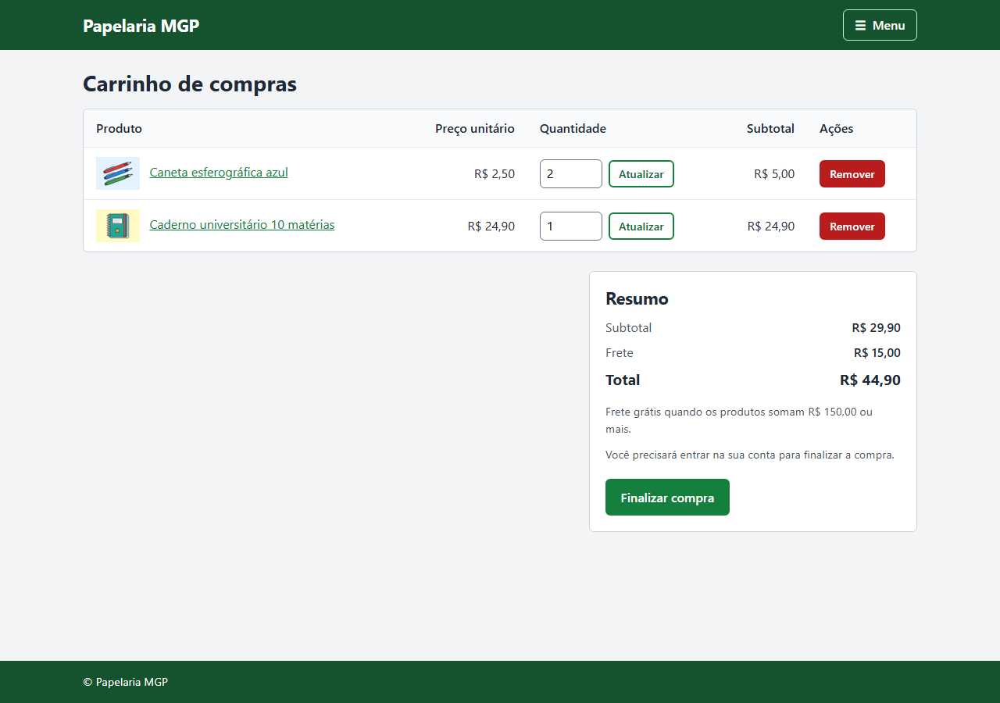

Entrar: formulário de login.

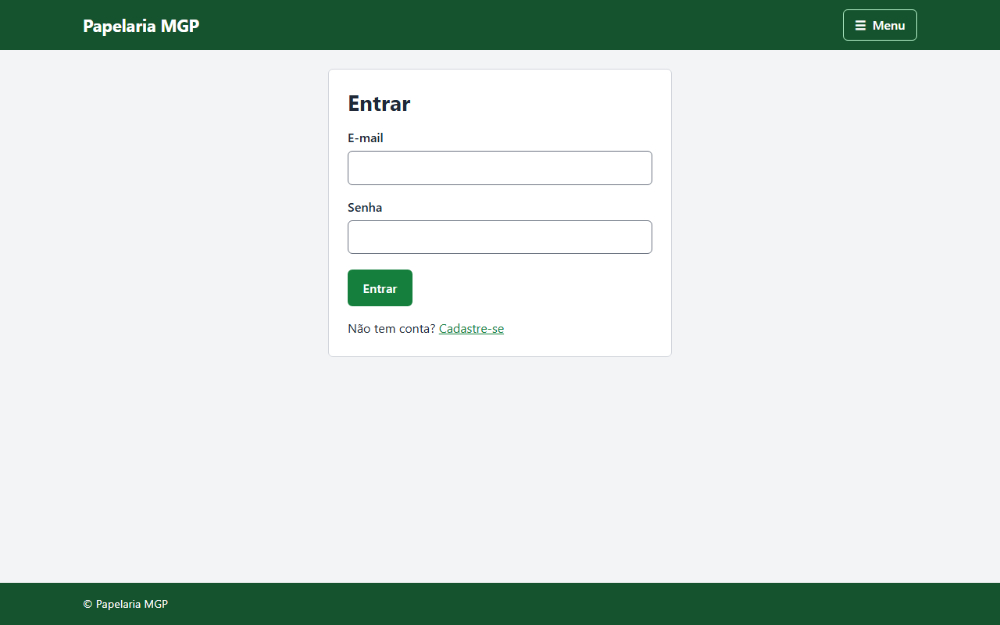

Criar conta: formulário de cadastro com a mensagem de erro de validação.

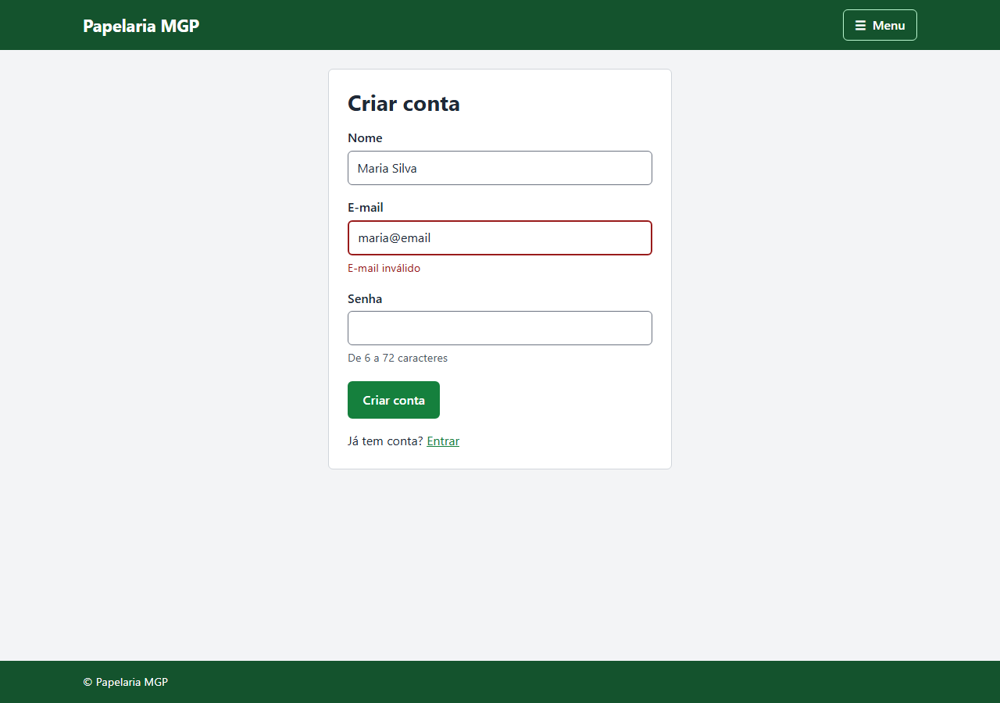

Meus pedidos: histórico do cliente com o status de cada pedido.

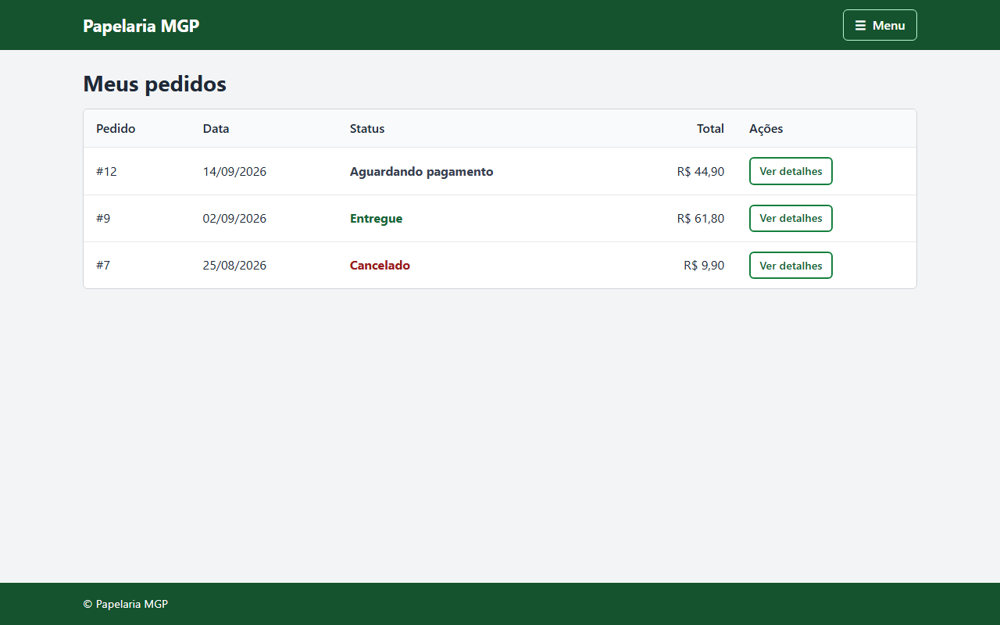

### Administração

Painel: números da loja e o menu da administração.

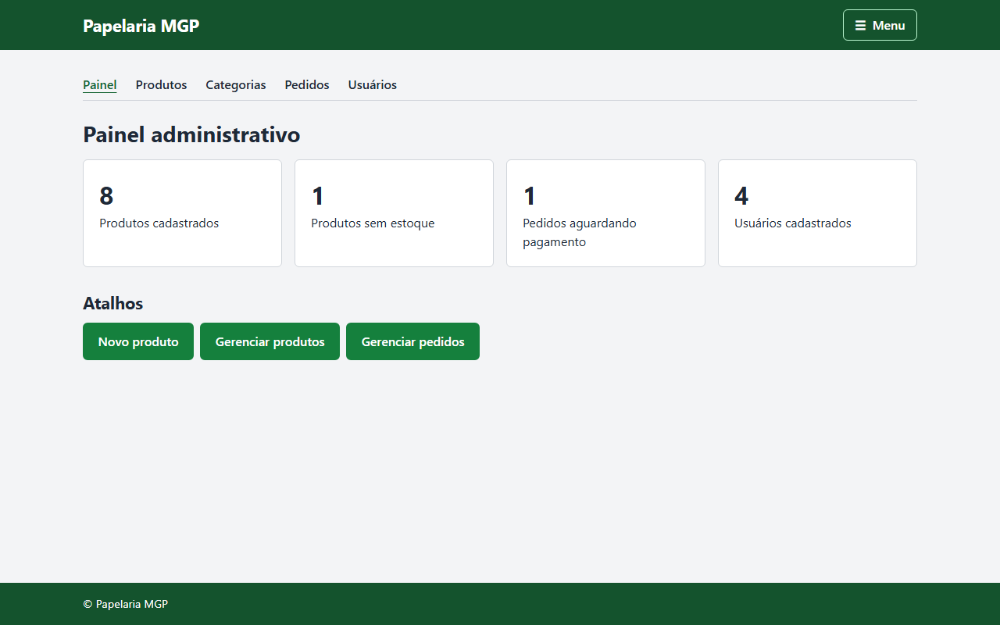

Pedidos: todos os pedidos, com a troca de status. Pedido cancelado não muda mais.

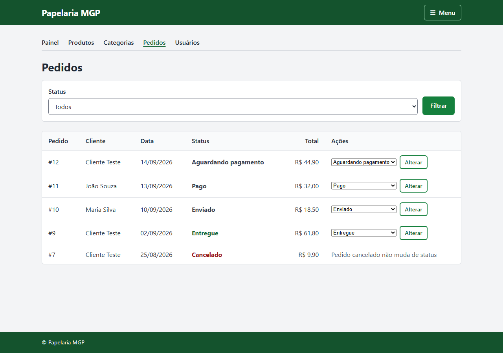

## Fluxo de CRUD (produtos)

O CRUD de produtos é o modelo para o cadastro de categorias. Para usuários haverá só a listagem
e a promoção de um cliente a administrador.

Listagem: tabela com todos os produtos, os botões Editar e Excluir em cada linha e o botão Novo
produto. Depois de salvar ou excluir, o sistema volta para esta tela com a mensagem de sucesso
ou de erro.

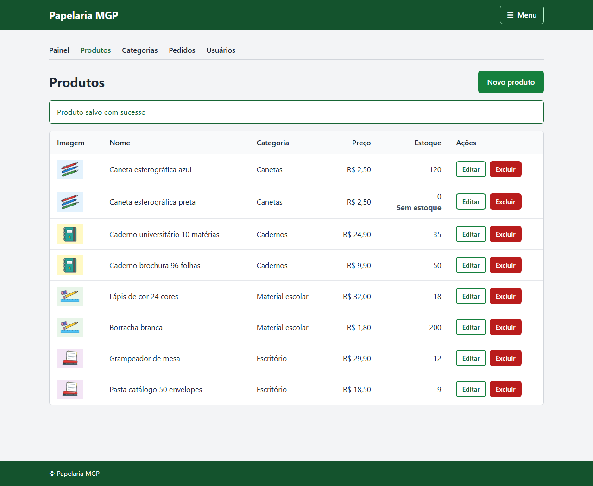

Cadastro: formulário em branco com nome, descrição, preço, estoque, categoria e imagem.

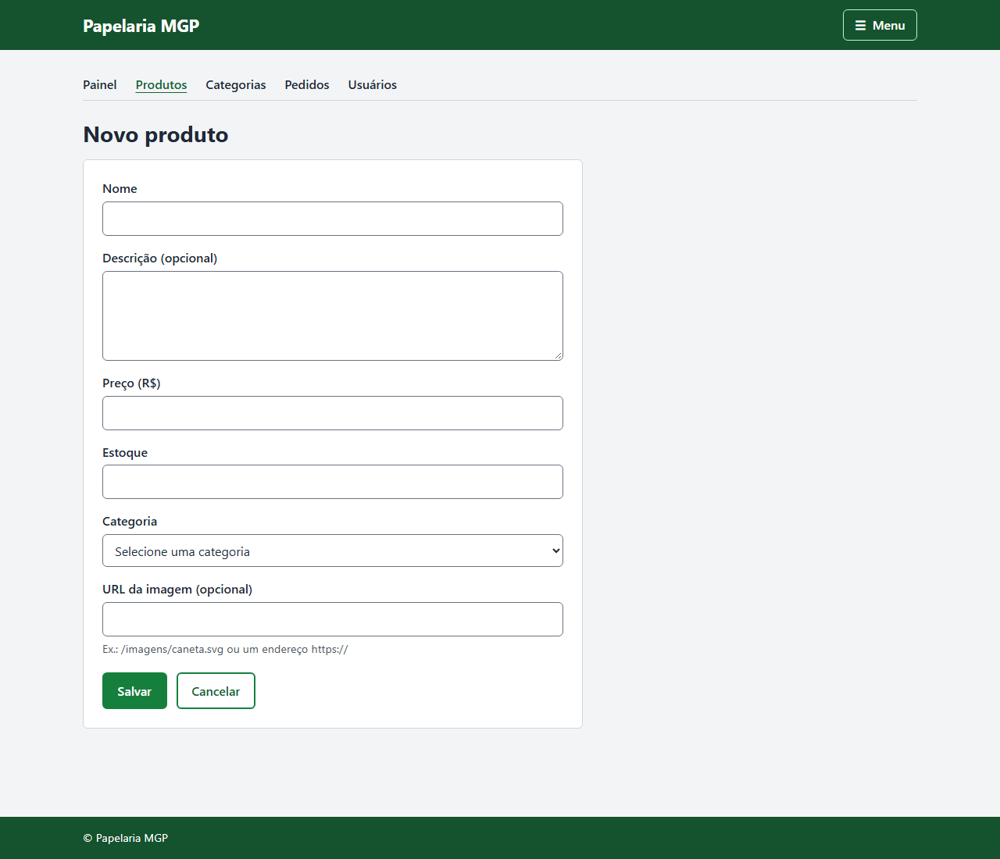

Edição: o mesmo formulário já preenchido com os dados do produto.

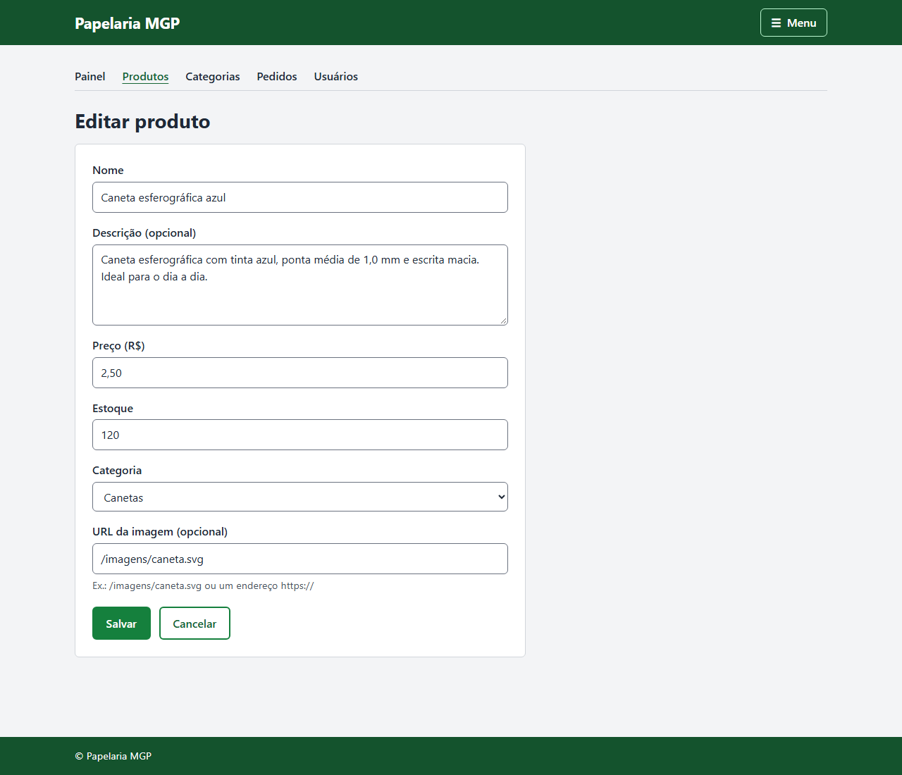

Exclusão: página de confirmação antes de excluir, com os botões Excluir e Cancelar.

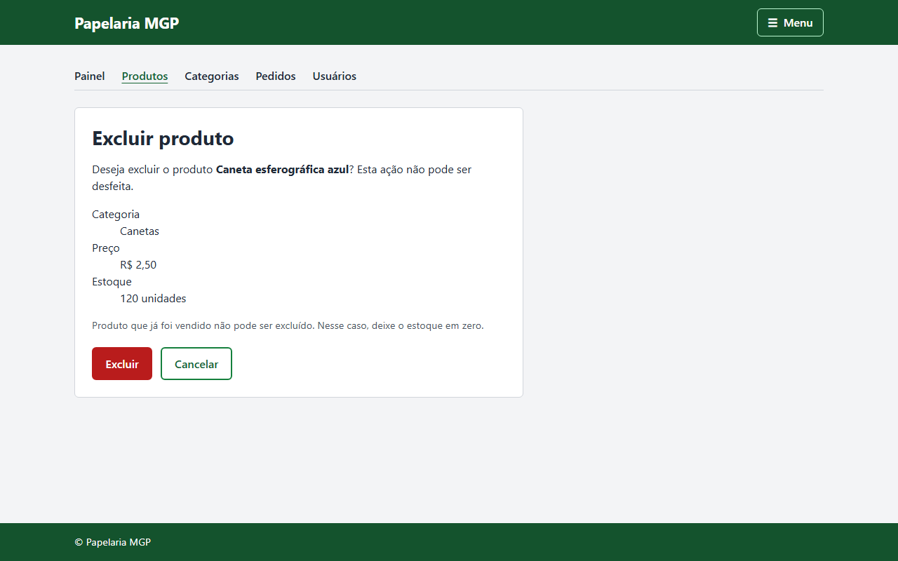

Como as telas se encadeiam:

```
                 Novo produto                    Salvar
  Listagem  ------------------>  Cadastro  ------------------>  Listagem
  (tabela)                       (formulário vazio)             (mensagem de sucesso)
     |
     |  Editar                                   Salvar
     +---------------------->  Edição  ---------------------->  Listagem
     |                         (formulário preenchido)          (mensagem de sucesso)
     |
     |  Excluir                                  Excluir
     +---------------------->  Confirmação  ----------------->  Listagem
                               (Cancelar volta                  (mensagem de sucesso
                                para a listagem)                 ou de erro)
```

Rotas planejadas:

| Ação | Método e rota |
|---|---|
| Listar | `GET /admin/produtos` |
| Abrir o formulário de cadastro | `GET /admin/produtos/novo` |
| Abrir o formulário de edição | `GET /admin/produtos/{id}/editar` |
| Salvar (cadastro ou edição) | `POST /admin/produtos/salvar` |
| Confirmar exclusão | `GET /admin/produtos/{id}/excluir` |
| Excluir | `POST /admin/produtos/{id}/excluir` |

## Planejamento de diferenciais

| Diferencial | Como vai funcionar |
|---|---|
| Cupom de desconto | Percentual ou valor fixo, com data de validade e uso único por cliente |
| Cálculo de frete | Grátis a partir de R$ 150,00 em produtos. Abaixo disso, valor fixo por faixa de itens |
| Avaliações | Só quem comprou o produto avalia, com nota de 1 a 5 e comentário. A página do produto mostra a média |
| Carrinho para visitante | O carrinho fica na sessão e o login só é pedido ao finalizar a compra |
| Controle de estoque automático | O estoque cai quando o pedido é confirmado e volta se o admin cancelar |
| Painel administrativo | Totais da loja e atalhos para os cadastros |
| Acessibilidade WCAG AA | Contraste conferido, navegação por teclado, ARIA e tags semânticas |
| Páginas de erro próprias | 403 e 404 com o visual do site |
